# Monster Hunter Helper — MHFU Helper (`.exe`)

> **Nota:** Este repositório distribui **apenas o executável (`.exe`)** na aba **Releases** (sem código-fonte).
  
> **Note:** This repository distributes **only the executable (`.exe`)** via **Releases** (source code is not included).

  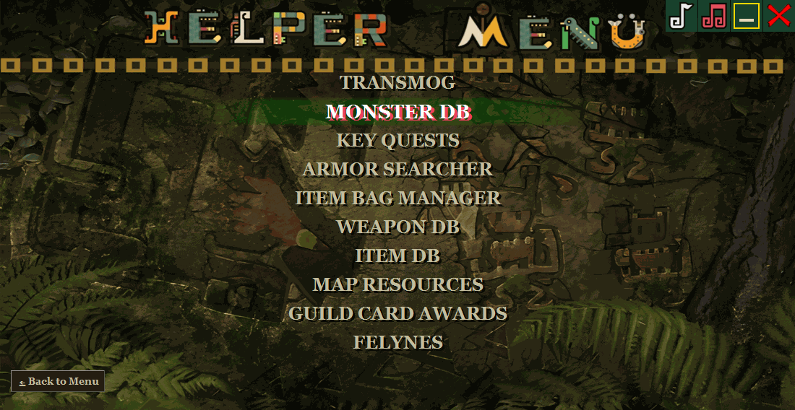

> Clique no idioma desejado abaixo para expandir

> Click your preferred language below to expand

<strong>🇧🇷 Português (PT-BR) — Guia Completo do App</strong>

### O que é o Monster Hunter Helper?

O **Monster Hunter Helper** é um projeto de aplicativos feitos para rodar offline no PC e servir como guia completo e utilitário para jogadores da franquia *Monster Hunter*, mantendo a estética, músicas e efeitos sonoros clássicos do jogo.

> 🎮 **Um aplicativo para cada jogo:**  
> Cada versão do **Monster Hunter Helper** é criada exclusivamente para um título específico da série, com banco de dados, mapas, equipamentos e recursos próprios daquele jogo.  
> Esta versão é o **MHFU Helper**, feita especialmente para **Monster Hunter Freedom Unite / Monster Hunter Portable 2nd G** (PSP / Emulador PPSSPP), com recursos de Transmog e Item Bag projetados para a **versão Japonesa com o patch FU Complete (`ULJM05500`)**.

### Destaques

- **Sem instalação:** Não precisa instalar nada — é só baixar, extrair e abrir.
- **100% Offline:** Todas as informações, imagens e mapas funcionam sem internet.
- **Compatibilidade:** Aplicativo compatível com sistemas operacionais 32bit e 64bit.
- **Português e Inglês:** Troque o idioma a qualquer momento diretamente na Tela Inicial.
- **Seus dados salvos:** Configurações, sets favoritos, presets de mochila e marcações de farm ficam salvos automaticamente ao lado do aplicativo.

---

### 📸 Prints por Tela

> *Clique em qualquer tela abaixo para abrir a print em tamanho grande:*

  
<b>01. Menu Principal</b>

  

    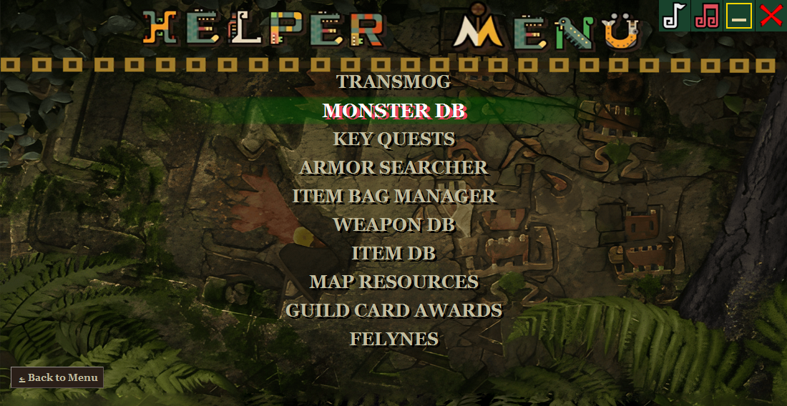
  

  
<b>02. Monster DB (Charts, Fraquezas &amp; Hitzones)</b>

  

    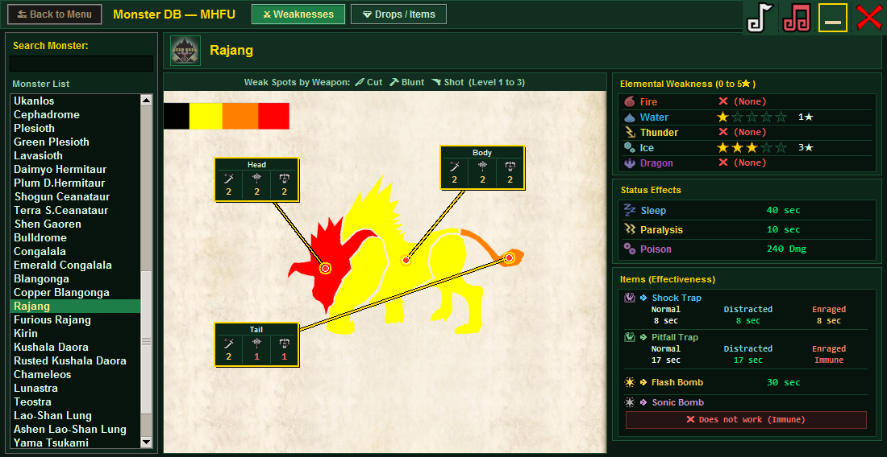
  

  
<b>03. Monster Drops (%)</b>

  

    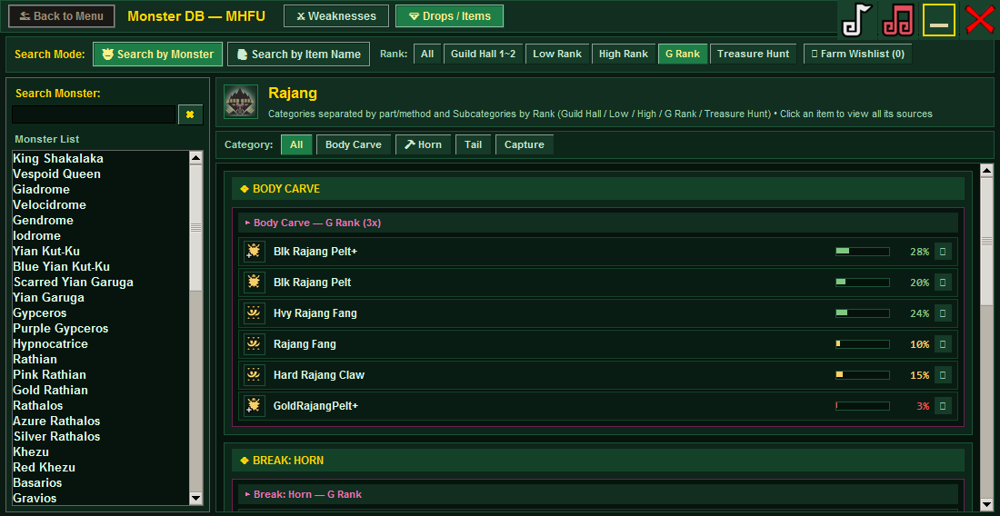
  

  
<b>04. Armor Searcher</b>

  

    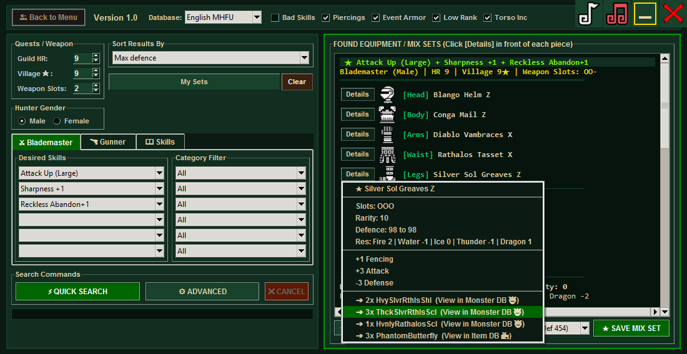
  

  
<b>05. Weapon DB (Afiação, Melodias &amp; Munições)</b>

  

    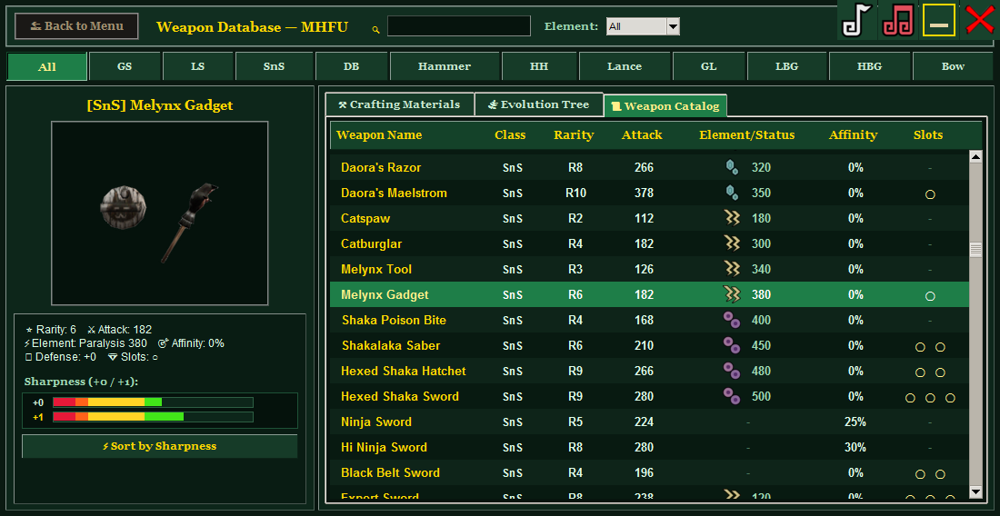
  

  
<b>06. Item DB</b>

  

    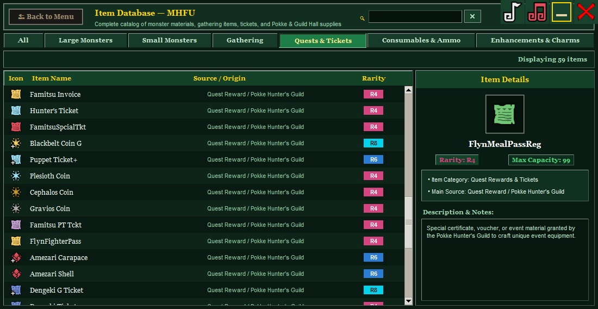
  

  
<b>07. Map Resources</b>

  

    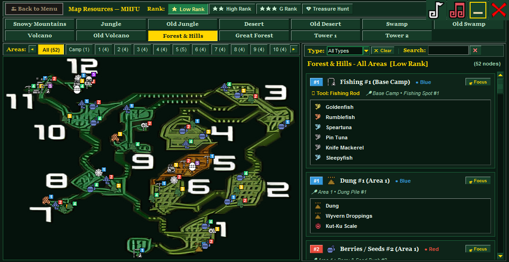
  

  
<b>08. Item Bag Manager</b>

  

    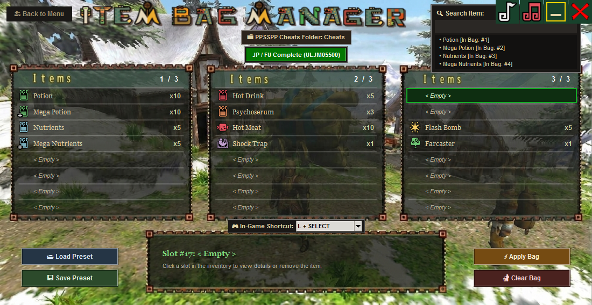
  

  
<b>09. Transmog (Armaduras, Armas &amp; Pigmento)</b>

  

    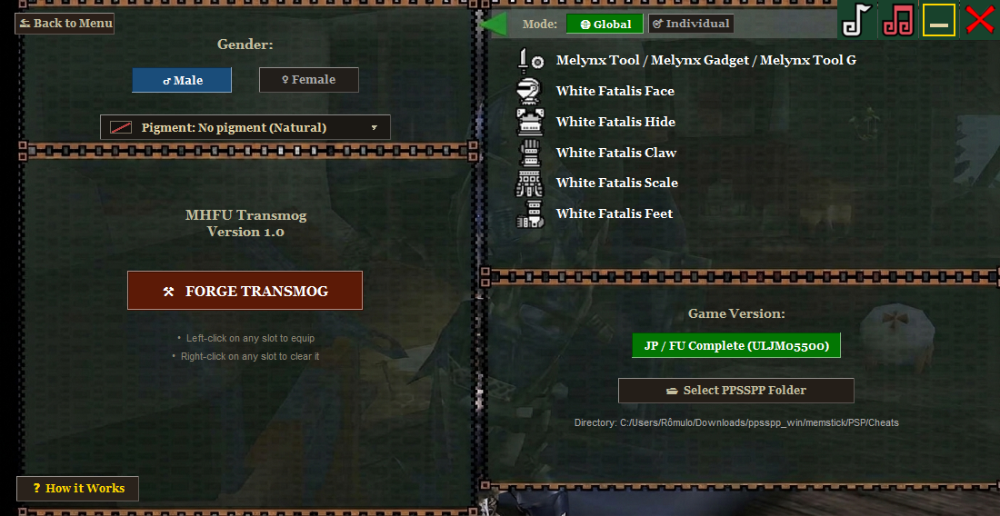
  

  
<b>10. Key Quests</b>

  

    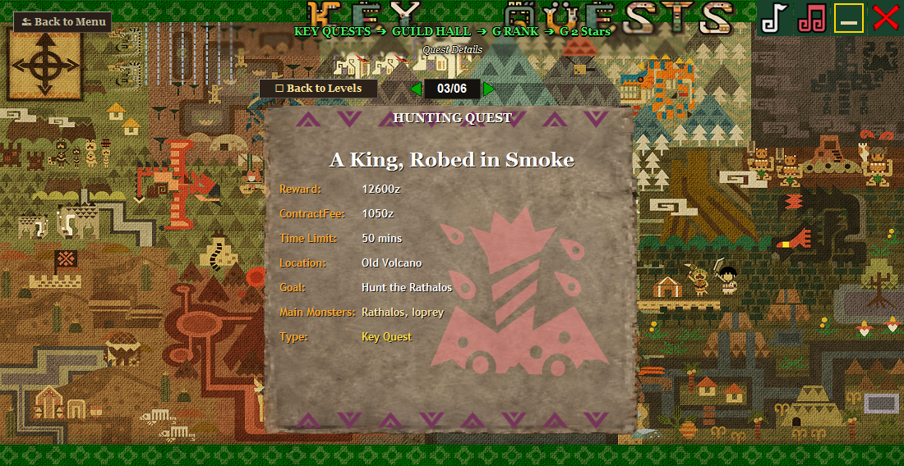
  

  
<b>11. Guild Card Awards</b>

  

    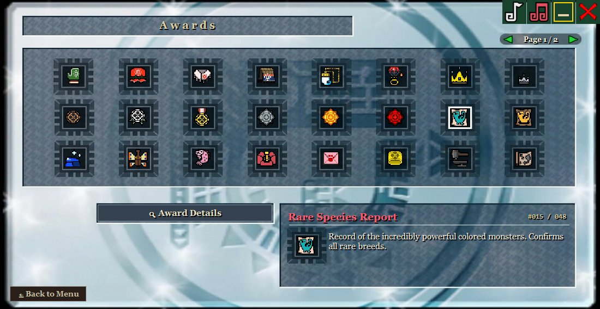
  

  
<b>12. Felynes (Comrade &amp; Kitchen)</b>

  

    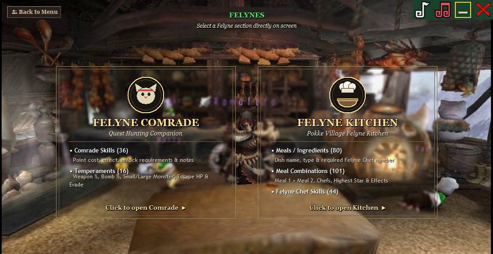
  

---

### Funcionalidades e Telas do App

#### 1. Tela Inicial e Menu Principal
- **Tela Inicial:** Seleção rápida de idioma (**PT / EN**), botão **Iniciar**, tela de **Créditos** e opção de **Doação**.
- **Menu Principal:** Central de navegação rápida no visual clássico de *Monster Hunter Freedom Unite*, com todas as **10 opções** reunidas em uma única página e botões globais para mutar/ativar música e efeitos sonoros, minimizar e fechar.

#### 2. Transmog (Armaduras, Armas Visuais & Pigmento)
- **Transmog de Armaduras:** Permite mudar a aparência de qualquer uma das 5 peças equipadas (**Cabeça, Peito, Braços, Cintura e Pernas**) — incluindo suporte a **Piercings / Chakra** e peças **Invisíveis** — mantendo intactos os status e skills reais da sua armadura, com suporte a **Masculino / Feminino** e **Blademaster / Gunner**.
- **Transmog de Armas:** Permite alterar a aparência da sua **arma equipada** para o visual de outra arma da mesma classe, preservando o ataque, elemento, afiação e slots da arma original.
- **Modo Global e Modo Individual por Item:** Escolha entre o **Modo Global** (substitui todos os equipamentos do slot) ou o **Modo Individual**, onde você muda somente o modelo visual de um item específico pelo visual escolhido (incluindo seus upgrades).
- **Sistema de Pigmento & Modo Rainbow:** Escolha manter a cor original do modelo 3D, manter o pigmento do jogo, aplicar qualquer uma das **11 cores sólidas** do MHFU ou ativar o modo **Rainbow (Arco-íris)** que alterna entre todas as cores.
- Conta com busca rápida por nome e aplica os códigos diretamente no arquivo de cheats do **PPSSPP** (`ULJM05500.ini`) para **JP / FU Complete** sem apagar outros cheats que você já tenha salvos.

#### 3. Monster DB — Monster Charts (Fraquezas e Áreas de Dano)
- **Imagem do Corpo e Hitzones:** Exibe o corpo do monstro com as áreas de dano de **Corte (Slash)**, **Impacto (Blunt)** e **Tiro (Shot)** para você saber exatamente onde bater.
- **Fraquezas Elementais e Status:** Mostra a eficácia de todos os elementos (*Fogo, Água, Trovão, Gelo e Dragão*) e status (*Veneno, Paralisia e Sono*).
- **Eficácia de Itens e Armadilhas:** Indica se *Pitfall Trap, Shock Trap, Flash Bomb e Sonic Bomb* funcionam no monstro, incluindo duração ou imunidade.
- **Estados do Monstro:** Monstros que mudam de forma, entram em fúria ou quebram partes permitem alternar o estado para ver as fraquezas e a imagem atualizadas.
- **Dicas de Caçada** e alternância rápida para os drops do monstro selecionado.

#### 4. Monster Drops (Drops e Farm)
- Mostra todos os itens que cada monstro dropa, separados por **Rank** (*Low Rank, High Rank e G-Rank*) e **Método** (*Carve, Captura, Quebra de Parte, Shiny Drop, Recompensa*), com quantidade e **porcentagem exata (`%`)**.
- **Busca por Monstro ou por Item:** Pesquise um monstro específico ou pesquise pelo nome do material para descobrir todos os monstros que dropam aquele item.
- **Etiquetas de Farm (Wishlist):** Marque os itens que você está farmando para destacar na lista e filtrar apenas os monstros que dropam o que você precisa.

#### 5. Key Quests
- Guia completo de progressão para **Vila** (*Velha da Vila + Nekoht High Rank*) e **Guild Hall** (*Low, High e G-Rank*), no estilo dos pergaminhos e fichas oficiais de quest do MHFU.
- Destaca todas as **Key Quests** obrigatórias e **Urgent Quests**, mostrando tipo da missão, objetivo, localização no mapa, taxa de contrato, recompensa e tempo limite.

#### 6. Armor Searcher
- Buscador completo de combinações de sets mistos de armadura para MHFU (baseado no **Athena's ASS**), totalmente integrado ao aplicativo.
- Filtre por **Estrelas da Vila (1★–9★)**, **HR da Guilda (1–9)**, **Gênero**, **Blademaster / Gunner**, **Slots da Arma (0–3)**, **Múltiplas Skills desejadas** e opções como *Piercings, Armaduras de Evento, Low Rank, Skills Negativas e Torso Inc*, além de ordenação por defesa ou resistências.
- Inclui **Busca Avançada** (para fixar ou excluir peças específicas), **Meus Sets** (para salvar seus builds favoritos) e listagem completa de decorações e **materiais necessários** para forjar o set.

#### 7. Item Bag Manager (Gerenciador de Mochila)
- Monte e salve presets completos para os **24 slots da mochila** (divididos em 3 painéis de 8 slots) respeitando o limite máximo de carregamento de cada item.
- Crie configurações prontas por tipo de caçada (ex.: *Gunner, Captura, Elder Dragon, Coleta*) e alterne entre elas rapidamente.
- Configure um atalho de botões e aplique o preset diretamente no **PPSSPP** (`ULJM05500` / *FU Complete*) com trava de segurança — só ativa com o Baú de Itens aberto dentro do jogo, exibindo som e notificação na tela.

#### 8. Weapon DB (Base de Dados de Armas)
- Enciclopédia com todas as **11 classes de armas** do MHFU (*GS, LS, SnS, DB, Hammer, HH, Lance, GL, LBG, HBG e Bow*), com filtros por classe, elemento/status, raridade e busca por nome.
- **Visualização das Armas:** Exibe a imagem oficial de cada arma junto com Ataque, Afinidade, Defesa extra e Slots.
- **Detalhes por Classe:** **Afiação de 7 níveis (Vermelho ➔ Roxo, base e com Sharpness +1)**, duplo elemento em **Dual Blades**, **Notas Musicais e Melodias com os buffs** (*Hunting Horn*), tipos de disparo (*Normal / Long / Spread*) em **Gunlance**, munições e *Rapid Fire* nas **Bowguns**, níveis de carga e revestimentos em **Arcos**, além de **Árvore de Upgrades** (precursoras e evoluções) e **materiais de Criação e Melhoria**.

#### 9. Item DB (Base de Dados de Itens)
- Catálogo pesquisável com todos os itens do MHFU, mostrando **raridade**, **limite máximo na mochila**, categoria, origem de obtenção, descrições e notas.
- Filtros por categoria (*Monstros Grandes, Monstros Pequenos, Coleta nos Mapas, Quests & Tickets, Combinações, Restos de Otomo, Esferas & Joias*), monstro associado ou tipo de recurso de coleta.

#### 10. Map Resources (Recursos dos Mapas)
- Mapas interativos de coleta para todos os **13 mapas do MHFU** separados pelos **4 Ranks oficiais** (*Low Rank, High Rank, G-Rank e Caça ao Tesouro / Treasure Hunt*).
- Pontos coloridos e numerados diretamente sobre o mapa (*Mineração, Insetos, Plantas, Cogumelos, Ossos, Pesca e Áreas Secretas*) exibindo cada item coletável, ferramenta necessária e **quantidade**.
- **Busca Global por Item nos Mapas:** Pesquise qualquer recurso para ver em quais mapas, áreas e pontos exatos ele aparece.

#### 11. Guild Card Awards (Medalhas do Guild Card)
- Exibe todas as **48 Awards do MHFU** divididas em **2 páginas de 24 slots**, com visualização fiel ao Guild Card do jogo.
- Passe o mouse sobre qualquer Award para ver o preview instantâneo e abra a janela de **Detalhes da Award** para conferir a categoria, descrição, **requisitos exatos para desbloquear** e dicas práticas.

#### 12. Felynes (Felyne Comrade & Felyne Kitchen)
- **Felyne Comrade:**
  - **Skills (36):** Lista filtrável por tipo de desbloqueio mostrando nome, **custo em pontos**, efeito completo, **requisito para liberar** e notas adicionais.
  - **Temperamentos (16):** Gráficos detalhados com a porcentagem de **Arma Principal**, **Bombas**, prioridade em **Monstros Pequenos / Grandes**, **HP de Fuga** (quando recua ao acampamento) e chance de **Esquiva**.
- **Felyne Kitchen:**
  - **Refeições (80 pratos):** Filtros por tipo de ingrediente (*Carne, Peixe, Laticínios, Vegetais, Grãos, Frutas e Bebidas*) e **Chef Number** (nº de Felyne Chefs necessários na cozinha).
  - **Combinações de Comidas (101 combos):** Filtre por **Meal 1**, **Meal 2**, **Chefs** e **Efeito** para consultar todos os bônus de status e o valor de **Highest Star** (*máximo de estrelas que ajuda a ativar Skills dos Chefs*).
  - **Skills dos Chefs Felynes (44):** Lista completa filtrável por categoria (*Combate, Coleta/Carga, Recompensas e Utilidade*) com descrições, observações de acúmulo e tradução.

---

### Conexões Inteligentes Entre Telas

As telas trabalham conectadas entre si para agilizar a sua caçada sem precisar ficar voltando ao menu e digitando tudo de novo:

- **Armor Searcher ➔ Monster Drops / Item DB:**  
  Ao clicar em qualquer material da lista de criação de um set:
  - Se for um **item de Boss / Monstro**, o app abre direto o **Monster DB na aba de Drops** já filtrado naquele item, mostrando de qual monstro dropa, método e qual a **`%`**.
  - Se for um **item geral** (minério, inseto, osso, ticket, etc.), abre direto o **Item DB** com o item selecionado.
- **Weapon DB ➔ Monster Drops / Item DB:**  
  Clicar em qualquer material na aba de criação ou upgrade de uma arma leva automaticamente para o **Monster Drops** (itens de monstro) ou para o **Item DB** (materiais gerais).
- **Monster DB (Charts) ⇄ Monster Drops:**  
  Alterne entre as **fraquezas/hitzones** e os **drops** mantendo o mesmo monstro selecionado, ou clique em qualquer item na lista de drops para ver todos os monstros que o dropam.
- **Item DB ➔ Map Resources:**  
  Para itens coletáveis nos mapas, basta clicar para ir direto ao **Map Resources** já mostrando em quais mapas, áreas e pontos aquele item pode ser coletado e com qual quantidade.
- **Botão "Voltar" Inteligente:**  
  Sempre que você pula de uma tela para outra, o botão **Voltar** lembra de onde você veio e retorna direto para a tela anterior sem perder sua pesquisa.

---

### 🛠️ Sistema de "Mods" via Cheats (Sem Alterar a ISO)

Diferente de mods tradicionais que exigem extrair, editar ou substituir arquivos internos da ISO do jogo, as funções de modificação do **MHFU Helper** (*Transmog* e *Item Bag Manager*) funcionam através do sistema nativo de **Cheats do PPSSPP**:

- **Sua ISO continua 100% intacta:** Não altera nem corre risco de corromper os arquivos originais do jogo.
- **Zero complicação:** Você não precisa extrair nem recompilar ISO — é só aplicar pelo app e jogar.
- **Liga e desliga na hora:** Basta ativar ou desativar no menu de cheats do emulador quando quiser, sem precisar desfazer alterações permanentes.
- **Compatível com FU Complete:** Projetado para a **versão Japonesa com patch FU Complete (`ULJM05500`)**, funcionando perfeitamente com traduções aplicadas via patch.
- **Preserva seus outros cheats:** O app escreve apenas a seção dele no arquivo de cheats do jogo (`ULJM05500.ini`), mantendo intactos quaisquer outros códigos que você já use.

---

### Como Usar

1. Baixe a versão mais recente na aba **[Releases](../../releases)** deste repositório.
2. Extraia o arquivo em qualquer pasta do seu PC.
3. Abra o **`MHFU_Helper.exe`**.
4. *(Opcional para Transmog e Item Bag Manager)* Selecione a pasta `PSP/Cheats` do seu **PPSSPP** dentro dessas telas e ative **"Enable Cheats"** nas configurações do emulador (requer a versão **JP / FU Complete `ULJM05500`**).

---

### 💬 Notas do Projeto, Créditos e Apoio

- **Desenvolvimento Assistido por IA (AI-Assisted):**  
  Este projeto é desenvolvido de forma **assistida por IA**, mas **não é "vibe coded"** — todo o código, comportamento das telas e informações do jogo são cuidadosamente revisados e validados manualmente. Apesar do auxílio da IA, há muito tempo e cuidado investidos aqui, já que o aplicativo está sendo desenvolvido, testado e revisado por **apenas uma pessoa**.
- **Comunidade e Créditos:**  
  O **Monster Hunter Helper** só é possível graças a inúmeras pessoas da comunidade que, ao longo de vários anos, pesquisaram, catalogaram e compartilharam informações, tabelas, ferramentas e imagens sobre o jogo. Todos os colaboradores e fontes de referência estão devidamente creditados na tela de **Créditos** dentro do próprio app.
- **100% Gratuito, Sempre:**  
  O aplicativo é **100% gratuito e sempre será** — feito de fã para fã. Se o app te ajudou nas suas caçadas e você quiser contribuir de forma opcional para agradecer e apoiar o projeto:  
  👉 **[Apoiar via LivePix](https://livepix.gg/romuleto)**

<strong>🇺🇸 English (EN) — Full App Guide</strong>

### What is Monster Hunter Helper?

**Monster Hunter Helper** is an offline desktop companion project built for *Monster Hunter* players, combining complete databases, set planning, and emulator utilities wrapped in the classic look and audio of the series.

> 🎮 **One dedicated app per game:**  
> Each **Monster Hunter Helper** release is built specifically for a different *Monster Hunter* title, with its own tailored databases, maps, gear tables, and features.  
> This release is **MHFU Helper**, made specifically for **Monster Hunter Freedom Unite / Monster Hunter Portable 2nd G** (PSP / PPSSPP emulator), with Transmog and Item Bag cheat features built for the **Japanese version with the FU Complete patch (`ULJM05500`)**.

### Highlights

- **No installation needed:** Just download, extract, and run.
- **100% Offline:** All databases, images, and maps work without an internet connection.
- **Compatibility:** App compatible with 32-bit and 64-bit operating systems.
- **English & Portuguese:** Switch languages anytime straight from the Title Screen.
- **Saved User Data:** Your settings, saved armor sets, item bag presets, and farm tags are saved automatically alongside the app.

---

### 📸 Screenshots by Screen

> *Click any screen below to expand it full-size:*

  
<b>01. Main Menu</b>

  

    
  

  
<b>02. Monster DB (Charts, Weaknesses &amp; Hitzones)</b>

  

    
  

  
<b>03. Monster Drops (%)</b>

  

    
  

  
<b>04. Armor Searcher</b>

  

    
  

  
<b>05. Weapon DB (Sharpness, Melodies &amp; Ammo)</b>

  

    
  

  
<b>06. Item DB</b>

  

    
  

  
<b>07. Map Resources</b>

  

    
  

  
<b>08. Item Bag Manager</b>

  

    
  

  
<b>09. Transmog (Armor, Weapons &amp; Pigment)</b>

  

    
  

  
<b>10. Key Quests</b>

  

    
  

  
<b>11. Guild Card Awards</b>

  

    
  

  
<b>12. Felynes (Comrade &amp; Kitchen)</b>

  

    
  

---

### App Screens & Features

#### 1. Title Screen & Main Menu
- **Title Screen:** Quick **EN / PT** language switch, **Start** button, **Credits**, and **Donate** popups.
- **Main Menu:** Classic *Monster Hunter Freedom Unite*–inspired navigation hub featuring all **10 tools** on a single page, plus global controls for Music, SFX, minimize, and close.

#### 2. Transmog (Visual Armor, Weapons & Pigment)
- **Armor Transmog:** Change the appearance of your 5 equipped armor pieces (**Head, Chest, Arms, Waist, and Legs**) — including **Piercings / Chakra** and **Invisible** options — while keeping your original armor stats and skills intact, supporting **Male / Female** and **Blademaster / Gunner**.
- **Weapon Transmog:** Change the visual appearance of your **equipped weapon** to another model from the same weapon class while preserving your original attack, element, sharpness, and slots.
- **Global & Individual Item Modes:** Choose between **Global Mode** (replaces all pieces in that slot) or **Individual Item Mode**, which replaces only the visual model of that specific chosen item (including its upgrade tiers) with the look you select.
- **Pigment & Rainbow Color System:** Keep natural 3D armor colors, keep your in-game pigment, apply any of the **11 solid MHFU pigments**, or enable **Rainbow** mode to cycle through all colors.
- Features quick name search and applies cheats directly to **PPSSPP** (`ULJM05500.ini`) for **JP / FU Complete** without erasing any other cheats you already have.

#### 3. Monster DB — Monster Charts (Weaknesses & Hitzones)
- **Monster Body & Damage Zones (Hitzones):** Shows full-body monster artwork with **Cut (Slash)**, **Impact (Blunt)**, and **Shot (Ammo)** hitzone values so you know exactly where to strike.
- **Elemental Weaknesses & Statuses:** Detailed ratings for **Fire, Water, Thunder, Ice, Dragon** and **Poison, Paralysis, Sleep**.
- **Item & Trap Effectiveness:** Shows whether *Pitfall Traps, Shock Traps, Flash Bombs, and Sonic Bombs* work on the monster, including durations or immunities.
- **Monster States:** Monsters with alternate forms, rage modes, or breakable parts let you toggle states to see updated artwork and weaknesses.
- **Hunting Tips** and instant switching to the selected monster's drops.

#### 4. Monster Drops (Drop Tables & Farm Tracker)
- Complete drop tables organized by **Rank** (*Low Rank, High Rank, G-Rank*) and **Method** (*Carve, Capture, Part Break, Shiny Drop, Quest Reward*) with quantities and **exact `%` rates**.
- **Search by Monster or by Item:** Browse all drops for a monster or reverse-search any material to see every monster that drops it.
- **Farm Tags (Wishlist):** Mark materials you are farming to highlight them and filter only the monsters that drop what you need.

#### 5. Key Quests
- Complete progression guide for **Village Quests** (*Village Elder + Nekoht High Rank*) and **Guild Hall** (*Low, High, and G-Rank*), styled after MHFU's quest scrolls and sheets.
- Highlights all mandatory **Key Quests** and **Urgent Quests**, showing quest type, goal, map location, contract fee, reward, and time limit.

#### 6. Armor Searcher
- Built-in mixed-set armor builder for MHFU (powered by **Athena's ASS**), fully integrated into the app.
- Filter by **Village ★ (1–9)**, **Guild HR (1–9)**, **Gender**, **Blademaster / Gunner**, **Weapon Slots (0–3)**, desired **Skills**, and options such as *Piercings, Event Armor, Low Rank, Bad Skills, and Torso Inc*, plus sorting by defense or elemental resistances.
- Includes **Advanced Search** (pin or exclude specific armor pieces), **My Sets** (save and manage your favorite builds), and a full breakdown of decorations and **required crafting materials**.

#### 7. Item Bag Manager
- Create and save **24-slot item pouch presets** (split across 3 panels of 8 slots) while respecting each item's maximum carry limit.
- Save loadouts for different hunts (e.g., *Gunner, Capture, Elder Dragon, Gathering*) and switch between them anytime.
- Set a button shortcut and apply presets directly in **PPSSPP** (`ULJM05500` / *FU Complete*) with a built-in safety check — only activates when your in-game Item Box is open, complete with native sound and notification.

#### 8. Weapon DB
- Complete encyclopedia covering all **11 MHFU weapon classes** (*GS, LS, SnS, DB, Hammer, HH, Lance, GL, LBG, HBG, and Bow*), with filters by class, element/status, rarity, and name.
- **Weapon Viewer:** Displays detailed artwork for each weapon alongside Attack, Affinity, Defense bonus, and Slots.
- **Class-Specific Details:** **7-tier Sharpness bars (Red ➔ Purple, base and Sharpness +1)**, dual-element **Dual Blades**, **Hunting Horn musical notes and Melodies with exact buffs**, **Gunlance** shell types (*Normal / Long / Spread*), **Bowgun** ammo & Rapid Fire tables, **Bow** charge levels & coatings, plus **Upgrade Trees** (predecessors and next upgrades) and **Craft / Upgrade materials**.

#### 9. Item DB
- Searchable item catalog covering all MHFU items, showing **rarity**, **max carry limit**, category, obtain source, descriptions, and notes.
- Filter by category (*Large Monsters, Small Monsters, Map Gathering, Quests & Tickets, Combinations & Consumables, Otomo Scraps, Spheres & Jewels*), associated monster, or gathering resource type.

#### 10. Map Resources
- Interactive gathering maps for all **13 MHFU locations** across all **4 official Ranks** (*Low Rank, High Rank, G-Rank, and Treasure Hunt*).
- Color-coded numbered spots placed directly on each map (*Mining, Bugs, Herbs, Mushrooms, Bones, Fishing, Secret Areas*) listing every item, required tool, and **amount**.
- **Global Reverse Item Search:** Look up any resource to highlight every map, area, and spot where it can be gathered.

#### 11. Guild Card Awards
- Displays all **48 MHFU Awards** across **2 pages of 24 slots**, styled to match the in-game Guild Card screen.
- Hover over any Award for an instant live preview, and open **Award Details** to view category, description, **exact unlock requirements**, and practical hunter tips.

#### 12. Felynes (Felyne Comrade & Felyne Kitchen)
- **Felyne Comrade:**
  - **Skills (36):** Filterable list showing skill name, **point cost**, full effect, **unlock requirement**, and additional notes.
  - **Temperaments (16):** Visual breakdowns for **Weapon %**, **Bomb %**, **Small / Large Monster target %**, **Escaping Health %** (camp retreat threshold), and **Evade %**.
- **Felyne Kitchen:**
  - **Meals (80 dishes):** Filter by ingredient type (*Meat, Fish, Dairy, Veggie, Grain, Fruit, Drink*) and required **Chef Number**.
  - **Meal Combinations (101 combos):** Filter by **Meal 1**, **Meal 2**, **Chefs**, and **Stat Effect** to inspect every bonus and its **Highest Star** rating (*max stars counted toward triggering Chef Skills*).
  - **Felyne Chef Skills (44):** Filterable list across *Combat, Gathering / Carry, Rewards, and Utility* with full descriptions and notes.

---

### Smart Cross-Screen Connections

Every screen is linked so you never waste time re-typing searches across menus:

- **Armor Searcher ➔ Monster Drops / Item DB:**  
  Click any material in a set's crafting list:
  - Clicking a **Boss / Monster material** jumps straight to **Monster DB → Drops** filtered on that item, showing which monsters drop it, the method, and the exact **`%`**.
  - Clicking a **general item** (ore, bug, bone, ticket, etc.) jumps straight to **Item DB** focused on that item.
- **Weapon DB ➔ Monster Drops / Item DB:**  
  Clicking any craft or upgrade material routes straight to **Monster Drops** (monster parts) or **Item DB** (general items).
- **Monster DB (Charts) ⇄ Monster Drops:**  
  Switch between **weaknesses/hitzones** and **drops** while staying on the same monster, or click any drop entry to see every monster that drops it.
- **Item DB ➔ Map Resources:**  
  For gatherable items, jump directly from **Item DB** into **Map Resources** showing every map, area, and spot where that item spawns along with amounts.
- **Context-Aware "Back" Button:**  
  Whenever you jump between screens, the **Back** button remembers where you came from and returns you straight to the previous screen with your search intact.

---

### 🛠️ Cheat-Based "Mods" System (No ISO Editing Required)

Unlike traditional mods that require unpacking, editing, or patching internal game files inside your ISO, **MHFU Helper**'s customization features (*Transmog* and *Item Bag Manager*) work through **PPSSPP's native Cheat system**:

- **Your ISO stays 100% untouched:** No risk of corrupting or modifying your original game files.
- **Zero hassle:** No ISO extraction, hex editing, or rebuilding needed — just apply through the app and play.
- **Toggle on/off anytime:** Enable or disable effects instantly in PPSSPP's cheat menu with no permanent changes.
- **FU Complete friendly:** Built for the **Japanese version with the FU Complete patch (`ULJM05500`)**, working seamlessly with translated/patched ISOs.
- **Keeps your existing cheats:** The app only updates its own sections in the cheat file (`ULJM05500.ini`) without wiping out any other cheats you already use.

---

### How to Use

1. Download the latest release from the **[Releases](../../releases)** tab.
2. Extract the folder anywhere on your PC.
3. Run **`MHFU_Helper.exe`**.
4. *(Optional for Transmog & Item Bag Manager)* Point to your **PPSSPP** `PSP/Cheats` folder inside those screens and turn on **"Enable Cheats"** in PPSSPP settings (requires **JP / FU Complete `ULJM05500`**).

---

### 💬 Project Notes, Credits & Support

- **AI-Assisted Development (Not "Vibe Coded"):**  
  This project is **AI-assisted**, not blindly *vibe coded* — all code, mechanics, and game data are manually reviewed, tested, and verified by a human. Even with AI assistance, a significant amount of time and effort goes into every update, as the entire project is built and reviewed by **a single solo developer**.
- **Community & Credits:**  
  **Monster Hunter Helper** is only possible thanks to the many people in the *Monster Hunter* community who have researched, compiled, and shared data, tools, guides, and artwork over the years. Everyone whose work helped make this possible is credited inside the **Credits** screen of the app.
- **100% Free Forever:**  
  This app is **100% free and always will be** — made by a fan, for fans. If it helped you on your hunts and you'd like to say thanks or optionally support ongoing development:  
  👉 **[Support on Ko-fi](https://ko-fi.com/romuleto)**

